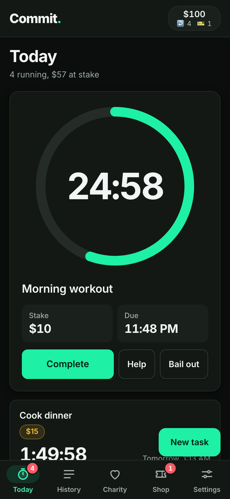
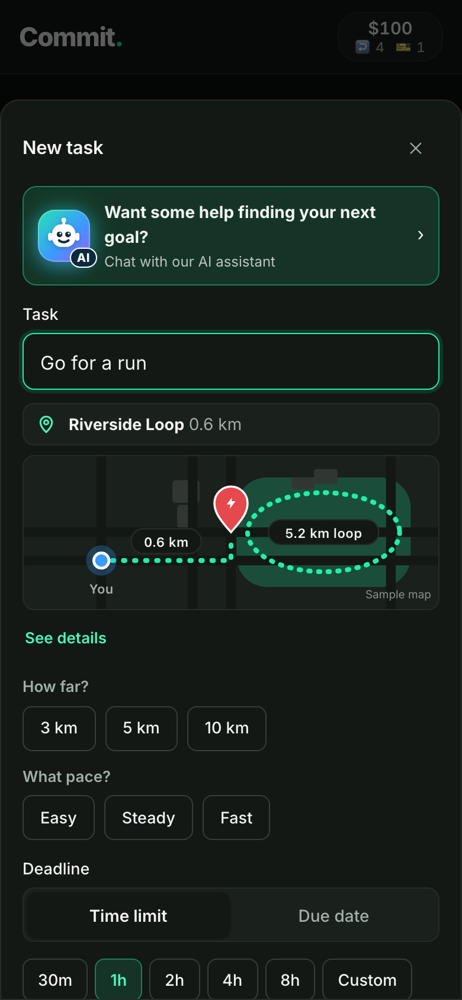
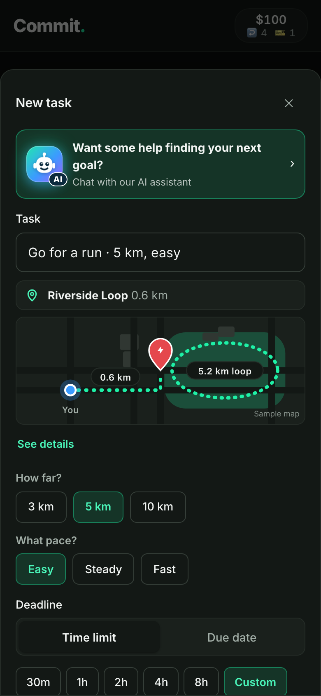
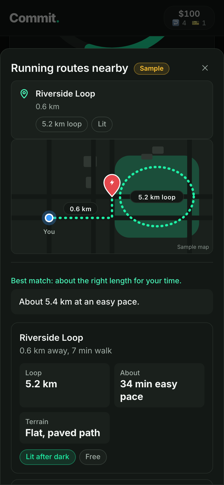
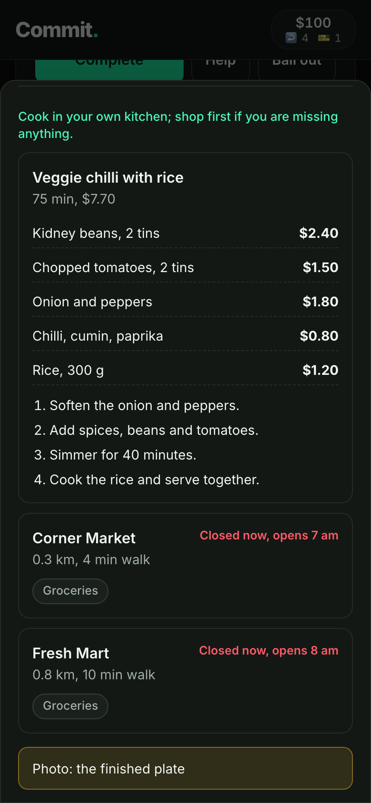
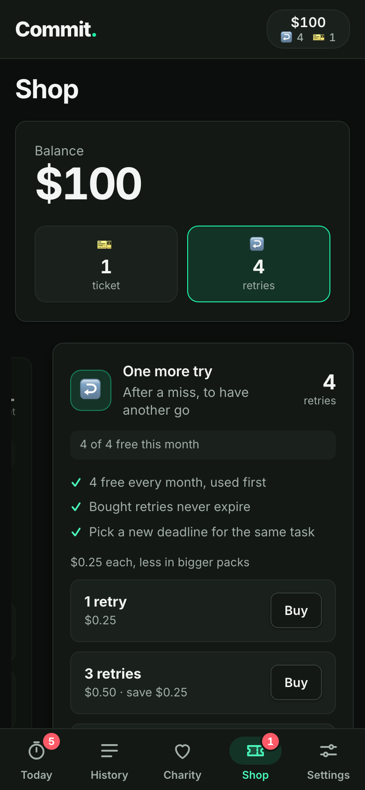

# HOW COMMIT. WORKS
### An 80-second screen tutorial · no actors, just the app

*Logline:* A calm voice walks a new user through the four things that matter: a few questions build your task, hints tell you how to do each step, a photo proves you did it, and if you miss, your stake helps a real cause.

**Format:** screen recordings of the app only, **dark theme throughout**. A friendly voiceover (VO), short on-screen captions, soft light music. No people on camera.

**Tagline:** *Put your money where your goals are.*

## RULES

- **Every shot is a real screen, dark theme.** Stills are in `video/screens/dark/` (the story set) and `video/screens/dark/tutorial/` (the extras for this film). Record the live flow from `phone.html`; the camera is simulated and the photo check passes.
- **Captions** are 3 to 6 words, bottom third, one at a time.
- **Taps** get a small ring so viewers see what is pressed.
- **Sound:** one soft two-note chime each time the app approves something (task live, photo verified). Nothing else loud.
- **Be honest on screen.** This is a prototype: partners, maps and charities are samples and no real money moves. The end card says so.

---

## SCENE 1 · THE IDEA · 0:00-0:06

**SCREEN:** Today, with a running countdown, the stake and **Complete / Help / Bail out**.

**CAPTION:** *Goals. With a price.*

> **VO:** We all know what we should do. Commit makes skipping it cost something.

---

## SCENE 2 · QUESTIONS BUILD YOUR TASK · 0:06-0:30

**SCREEN:** Tap **New task**. Type a plain goal: *Go for a run*. The app instantly asks two questions, **How far?** and **What pace?**, and shows a route map.

**CAPTION:** *Type a goal. Answer two questions.*

> **VO:** Type any goal. Commit asks what it needs to know: how far, what pace.

**SCREEN:** Tap **5 km**, then **Easy**. The task name rewrites itself to *Go for a run · 5 km, easy* and the time limit adjusts to fit.

**CAPTION:** *Your answers become the task.*

> **VO:** Your answers write the task and set the time limit for you. Pick a stake, tap Start, and it's live. **Chime.**

**SCREEN:** Back at the top of **New task**, tap the banner *"Want some help finding your next goal?"* The chat opens with *"How are you feeling right now?"* A finger taps an answer.

**CAPTION:** *No idea? Let it ask you.*

> **VO:** Not sure what to do at all? The assistant asks how you feel, where you are and how much time you have.

**SCREEN:** Three ideas appear, one a highlighted partner offer.

**CAPTION:** *Three ideas, made for right now.*

> **VO:** Then it hands you three ideas that fit this moment. One tap starts any of them.

---

## SCENE 3 · HINTS FOR EVERY STEP · 0:30-0:50

**SCREEN:** On a running task, tap **Help**. The sheet opens with *Running routes nearby*: a map with you, the route and the loop, then the distance, easy pace time, terrain and "Lit after dark".

**CAPTION:** *Hints for how to do it.*

> **VO:** Stuck on how to do it? Tap Help. You get the best route near you, how long it will take and what the ground is like.

**SCREEN:** A partner offer with its route and a code to show on arrival.

**CAPTION:** *Claim the offer. Show the code.*

> **VO:** Partner offers come with a code to show when you get there.

**SCREEN:** On *Cook dinner*, tap **Help**. Scroll to a recipe: ingredients with prices, then four numbered steps. Two nearby shops follow, and the last line says what photo to take.

**CAPTION:** *Step by step. No guessing.*

> **VO:** Cooking? You get the ingredients, what they cost, and the steps in order. It even tells you which photo to take.

---

## SCENE 4 · PROVE IT · 0:50-1:02

**SCREEN:** Tap **Complete**. The camera opens. Tap the shutter.

**CAPTION:** *Done? Show it.*

> **VO:** When you're finished, take a photo. No honest photo, no completion.

**SCREEN:** The checklist ticks through: *Scanning photo*, *Matching task*, *Checking for edits*. Then the result card. **Chime.**

**CAPTION:** *Verified. You keep your stake.*

> **VO:** The app checks the photo matches your task and tells you how sure it is. Verified, and your money stays yours.

---

## SCENE 5 · IF YOU MISS, SOMEONE WINS · 1:02-1:16

**SCREEN:** **History**, **Missed** filter: *Meal prep, to Ocean Cleanup Alliance, -$10*.

**CAPTION:** *Miss it? Your stake gives.*

> **VO:** Miss the deadline and your stake isn't wasted. It goes to the charity you picked.

**SCREEN:** Tap the **Charity** tab. The chosen charity fills the top: what it does, a progress bar (*$1,240 of $2,000*) and **You gave $10**. Scroll to the others, each with its own bar and a **Choose** button.

**CAPTION:** *Failing still helps real people.*

> **VO:** Every charity shows how close it is to its goal, and how much you've given. Pick the cause you care about: clean oceans, hot meals, books for children, clean water.

---

## SCENE 6 · A SECOND CHANCE · 1:16-1:22 *(optional, cut first if over time)*

**SCREEN:** **Shop**, **One more try** card: *4 of 4 free this month*, *Pick a new deadline for the same task*. Swipe to the bail-out ticket.

**CAPTION:** *Life happens. Try again.*

> **VO:** Real life gets in the way. Take one more try, or use a bail-out ticket to keep your money.

---

## SCENE 7 · END CARD · 1:22-1:26

**SCREEN:** **Commit.** logo on black, the green dot pulses once.

> **Put your money where your goals are.**
> *Prototype: sample partners and charities. No real money moves.*

**SOUND:** the chime, one last note.

> **VO:** Commit. Win, and you keep it. Miss, and someone else wins.

---

## SHOOTING NOTES

| Need | How |
|---|---|
| Re-shoot the extra screens | `cd video && npm run tutorial-screens` (dark theme, deterministic). Re-shoot the story set with `npm run screens`. |
| All live flows | Run `python app.py` and open `phone.html`, or use the capture tools, which start their own server. Tap **Try the demo**. |
| Charity impact lines | The data holds a per-$10 impact (for example *plants about 5 trees*), but the Charity screen **doesn't show it yet**. Keep the VO to what is on screen, or add the line to the UI first. |
| Missed-task shot | The demo account already has missed tasks in History. Cut straight to History rather than waiting for a timer to lapse. |
| Length | About 86 seconds with Scene 6, about 80 without. |

*Related: the story-driven 2:00 film is in `option-a-where-you-started.md`. This is the plain how-to version of the same flows.*
